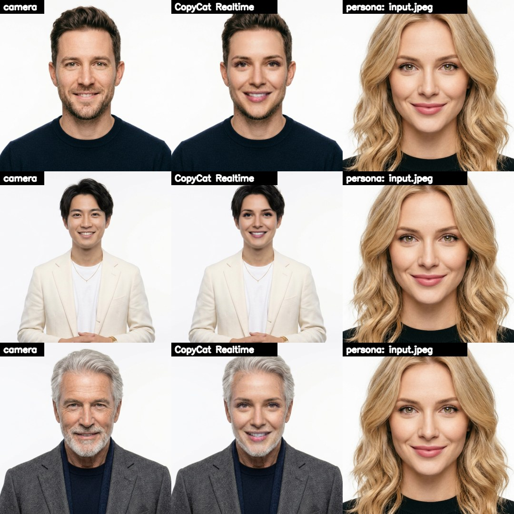
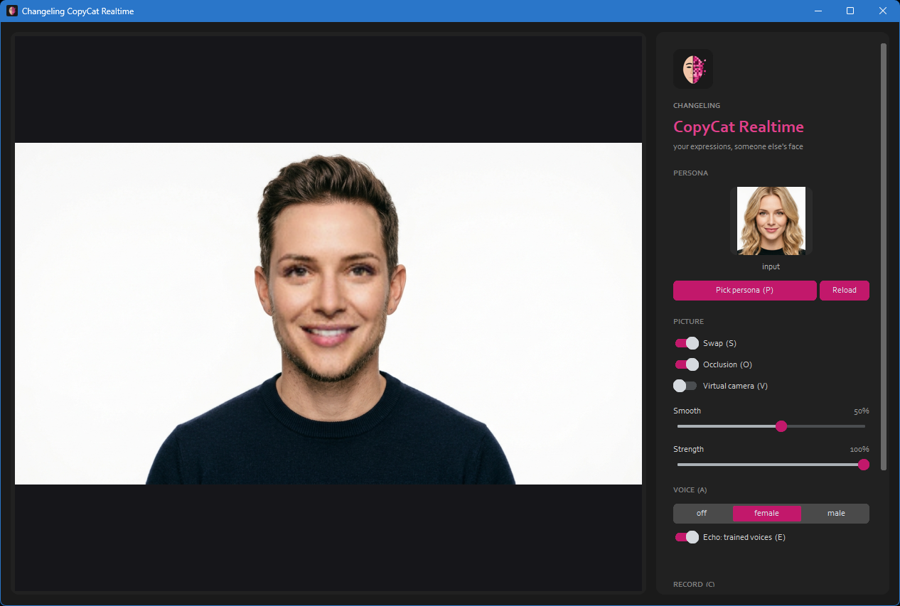
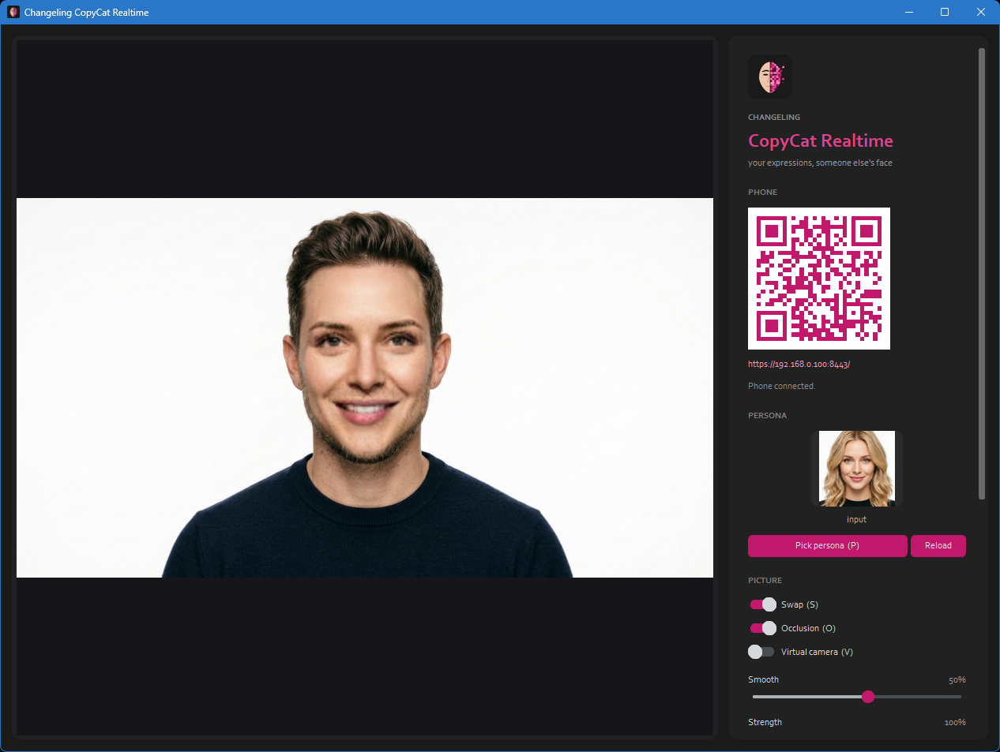

  

# Changeling Imago Realtime

*Part of the Changeling family, all together in [Changeling Studio](https://github.com/CursedPrograms/Changeling-Studio):
[Imago](https://github.com/CursedPrograms/Changeling-Imago) ·
**Imago Realtime** ·
[Tiresias](https://github.com/CursedPrograms/Changeling-Tiresias) (gender) ·
[Chronos](https://github.com/CursedPrograms/Changeling-Chronos) (age) ·
[Natio](https://github.com/CursedPrograms/Changeling-Natio) (where in the world) ·
[Cosmeta](https://github.com/CursedPrograms/Changeling-Cosmeta) (makeup, hair, beards) ·
[Echo](https://github.com/CursedPrograms/Changeling-Echo) (voices) ·
[Tonsor](https://github.com/CursedPrograms/Changeling-Tonsor) (hairstyles) ·
realtime: [Tiresias](https://github.com/CursedPrograms/Changeling-Tiresias-Realtime) ·
[Chronos](https://github.com/CursedPrograms/Changeling-Chronos-Realtime) ·
[Natio](https://github.com/CursedPrograms/Changeling-Natio-Realtime) ·
[Cosmeta](https://github.com/CursedPrograms/Changeling-Cosmeta-Realtime).*

**Website:** https://cursedprograms.github.io/Changeling-Imago-Realtime/

*Imago* is Latin for a likeness, and the Romans' word for the wax masks cast from a person's face and kept in the family hall: a copy of a face that someone could wear. (It's also where "image" comes from.)

A live face swap for video calls. You become the face in `personas/input.jpeg`, with your own expressions
(your smile, your blinks, your mouth as you talk), and your call (Zoom, Teams, Discord, Meet) sees it as an
ordinary camera. The personas are **AI-generated people who don't exist**.

Each row above: a face as the camera sees it, the same frame through Changeling Imago Realtime, and the persona.

## Use it

1. Put the persona's face in `personas/input.jpeg` (see below; the repo comes with one).
2. Start `run.bat` (or `.\run.ps1` in PowerShell, `./run.sh` in Git Bash or Linux). The first time it sets itself up: Python 3.11, PyTorch's CUDA libraries, InsightFace
   and the GPU ONNX runtime (about 3 GB), the swap model (`models/inswapper_128.onnx`, about 550 MB) and
   the occlusion model (`models/xseg_1.onnx`). Optional too: **Sharper face**'s model, `models/gfpgan_1.4.onnx` (GFPGAN v1.4 as ONNX; also looked for in `F:\AIModels\faceswap`). Make it once from `GFPGANv1.4.pth` with `scripts/export_gfpgan.py` (run it with Changeling Imago's `psdenv`, which has gfpgan). An NVIDIA GPU is needed for a usable frame rate.
3. A dialog asks first: **use the default input (`personas/input.jpeg`)?** Yes for her; No opens a file
   picker in `personas/` to become someone else this time.
4. In your call, pick the camera **OBS Virtual Camera** (OBS Studio installed; it doesn't have to run).

The window (Changeling's look): the picture on the left; on the right the persona with **Pick persona**
and **Reload**, switches for the swap, occlusion and the virtual camera, the smooth and strength sliders,
the voice, and **Record**.

| Key | Does |
| :--- | :--- |
| <kbd>S</kbd> | swap on / off |
| <kbd>O</kbd> | occlusion on / off: hands, hair, a cup in front of your face stay in front of hers |
| <kbd>H</kbd> | **Sharper face** on / off: GFPGAN redraws the swapped face at 512 x 512 (the swap itself draws it at 128 x 128, which looks soft and blocky up close); about half the frame rate |
| <kbd>V</kbd> | virtual camera on / off |
| <kbd>A</kbd> | voice: off, female, male |
| <kbd>E</kbd> | Echo on / off: female and male in Changeling Echo's trained voices |
| <kbd>C</kbd> | record / stop: the swapped picture and your voice, to `recordings/` |
| <kbd>P</kbd> | pick another persona: a file picker in `personas/`, no restart |
| <kbd>R</kbd> | read the persona's picture again (after replacing it) |
| <kbd>Q</kbd> or <kbd>Esc</kbd> | quit |

| Slider | Does |
| :--- | :--- |
| smooth % | steadies where the face sits from frame to frame (less jitter; too much and it lags) |
| strength % | how much of the swapped face shows: 100 is all of it |
| persona's skin % | how much of her skin you wear too: its tone and its fine detail (wrinkles, freckles, pores), which the swap alone leaves as yours. 0 by default; Changeling's realtime apps (Chronos, Natio, Tiresias Realtime) start it at 70. Your neck and ears keep your own tone, so a big change of skin tone shows at the jaw near 100 |

### The voice

**Female** takes your voice to a woman's pitch (about 210 Hz), the formants (the resonance that sounds man
or woman) up with it; **male** to a man's (about 115 Hz). Your own pitch is learned as you talk, so a deep
voice and a light one both land in the right range. It's a phase vocoder on the CPU, about a tenth of a
second behind. To reach your call it needs [VB-Audio Virtual Cable](https://vb-audio.com/Cable/) (pick
**CABLE Output** as the call's microphone); without it the voice still goes into recordings.

**Echo** (the switch under the voices, <kbd>E</kbd>, or `--echo`) speaks female and male in a trained voice
instead: [Changeling Echo](https://github.com/CursedPrograms/Changeling-Echo)'s `echo_female` and `echo_male`
(RVC). Your words and timing, someone else's voice, rather than yours moved up or down. It runs on the graphics
card in Echo's own environment (Echo's `echo/live.py`, a child process), a quarter second at a time: about a
third of a second behind you, under 100 ms of work per quarter second on a 6 GB card. It takes about
9 seconds to load the first time you pick a voice, and the phase vocoder speaks until it's ready. It needs
Changeling Echo next to this app (as in Changeling Studio) or in `ECHO_DIR`, with its voices trained.
Measured here: a man's voice at 158 Hz came out at 214 Hz as `echo_female`, and a woman's at 195 Hz came out
at 118 Hz as `echo_male`.

### Your phone as the camera

`run_server.bat` (or `run_server.ps1`, `run_server.sh`; it's `run.bat --phone`) uses your phone's camera and
microphone instead of a webcam, while this PC does the swap. The window shows a QR code: scan it with the phone
(on the same WiFi), accept the certificate warning once (the page makes its own certificate, because phones only
give a page the camera and microphone over HTTPS), and press **Start**. The phone sends its camera a picture at a
time and gets the swapped picture back on its screen; its microphone goes through the voice changer (and Echo). Out
to the call it's the same as a webcam: OBS Virtual Camera, the virtual cable, recordings. Tested here with a script
playing the phone: about 12 swapped pictures a second came back over the local network.

The page is on port 8443 (`--phone-port` changes it). Windows asks once whether Python may take connections on
your network: allow it on private networks. `phone.py` is the server, `phone_page/` the page.

**HD** on the phone's page (on by default) sends and gets back pictures up to 1280 pixels at a high JPEG quality;
off is 640 pixels (less WiFi, a little faster). The pictures can be upright or sideways: the virtual camera gets
them fitted into its own size, with dark bars.

### Recording

**Record** saves what the call would see and hear: the swapped picture and your voice (changed, or your
own with the voice off) as one `.mp4` in `recordings/`, named by date and time. The picture is written at a
steady 30 fps in step with the sound; ffmpeg joins them at Stop. Click the line under the button to open
the folder.

`run.bat --camera 1` (another webcam), `run.bat --source clip.mp4` (a video or picture instead of the
webcam), `run.bat --no-virtual` (just the preview), `run.bat --voice female --echo` (start with a voice, in Echo's), `run.bat --skin 70` (the persona's skin slider),
`run.bat --mic "Focusrite"` (pick the microphone by part of its name), `run.bat --persona test2` (skip the question: a picture in `personas/` by name, or any file), `run.bat --source me.jpg --snapshot out.png` (one
swapped frame, to try a persona).

## The personas

Generated people who don't exist (AI Visual Workshop, Gemini...), not photos of real people: becoming a
real person on a call isn't fair on them. What works best:

- looking straight at the camera, the whole face visible: no hands or hair over the eyes or mouth
- even light, sharp, a neutral face or a slight smile
- one face per image (if there are more, the biggest is used); a tight close-up is fine too

## What it swaps, and what it doesn't

- The face: the persona's features and skin, your expressions and head movements.
- Not your hair, neck or body: a hood or a wig helps a lot. The voice is its own switch (above).
- Best facing the camera: sharp side profiles and hands over the face make it slip for a moment.

## How it works

InsightFace finds the face in every frame (SCRFD, from the `buffalo_l` models in `~/.insightface`), its
five key points are steadied against the last frame's, and `inswapper_128` draws the persona's identity
(taken once from her image with InsightFace's recognition model) onto your face, all on the GPU through
onnxruntime-gpu. FaceFusion's XSeg occluder marks what's in front of your face (hands, hair, a cup) every
other frame, and the swap is left out there; when you blink, your own closed eyes show through. The
finished frame goes to the preview and to OBS's virtual camera.

InsightFace's models (`buffalo_l`, `inswapper_128`) are for non-commercial use only.

---

 

© Cursed Entertainment 2026

 

 

  

